# 2026-salmonbus

## 오늘은 늦지 않게 출근할 수 있을까?

아침 8시입니다. 아래에서 생각을 하나 골라 눌러 보세요. 고른 길이 그 아래에 펼쳐집니다.

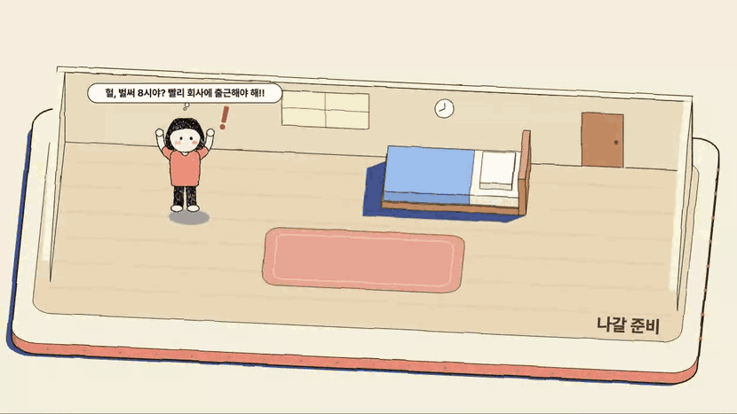

<b>어, 한번 열어 봤는데 3석 남는대!</b>

 

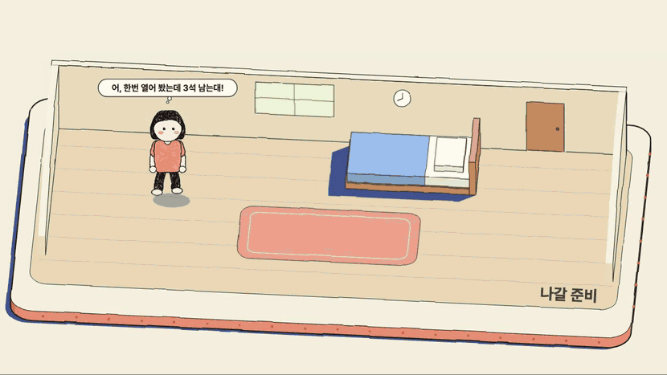

<b>고양이 쓰다듬기</b>

 

헐, 시간이 없어! 위나 아래에서 다시 골라 보세요.

<b>어, 내 정류장으로 가도 되겠다!</b>

 

<b>버스 온다! 오, 자리 있다!</b>

 

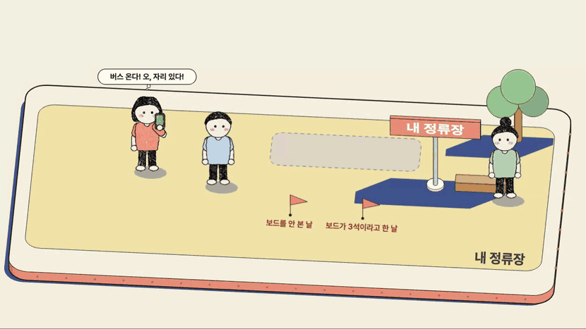

<b>얼른 타자!</b>

 

<b>회사 앞이다, 내리자!</b>

 

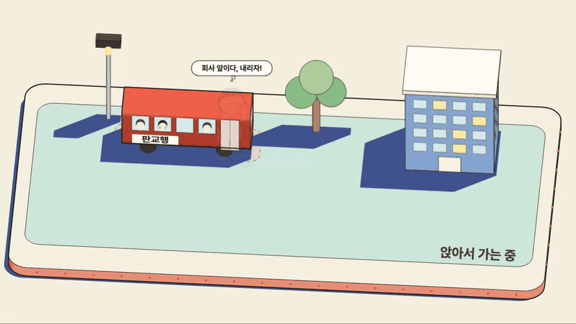

회사에 도착했습니다. 오늘 출근길은 여기까지입니다.

<b>버스 온다! 헐, 만석이야...</b>

 

<b>이건 보내고 다음 차를 보자. 오, 다음 차는 3석 남는대!</b>

 

<b>그럼 여기서 기다리자!</b>

 

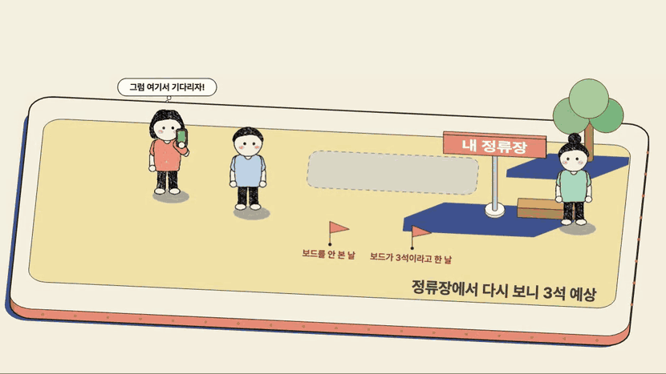

<b>버스 온다! 오, 자리 있다!</b>

 

<b>얼른 타자!</b>

 

<b>회사 앞이다, 내리자!</b>

 

회사에 도착했습니다. 오늘 출근길은 여기까지입니다.

<b>버스 온다! 헐, 만석이야...</b>

 

<b>이건 보내고 앞 정류장으로 걸어가자!</b>

 

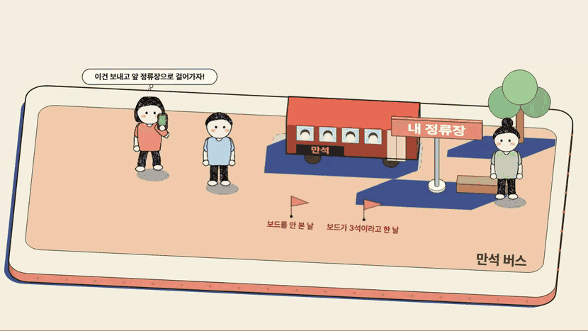

<b>여기는 자리 있다, 타자!</b>

 

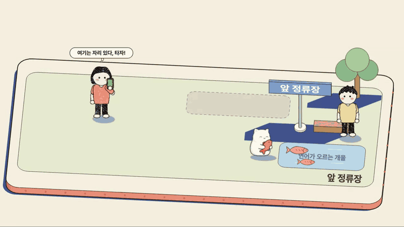

<b>회사 앞이다, 내리자!</b>

 

회사에 도착했습니다. 오늘 출근길은 여기까지입니다.

<b>이건 보내고 다음 차를 보자. 헐, 다음 차도 자리가 없대...</b>

 

<b>앞 정류장으로 옮겨서 타자!</b>

 

<b>여기는 자리 있다, 타자!</b>

 

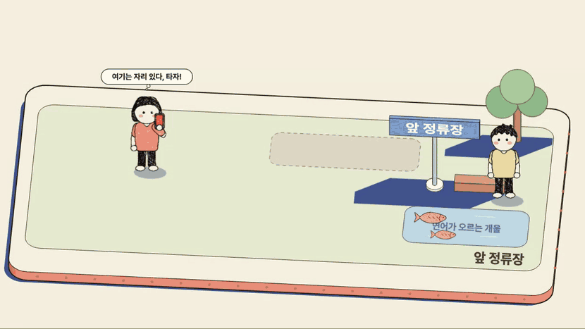

<b>회사 앞이다, 내리자!</b>

 

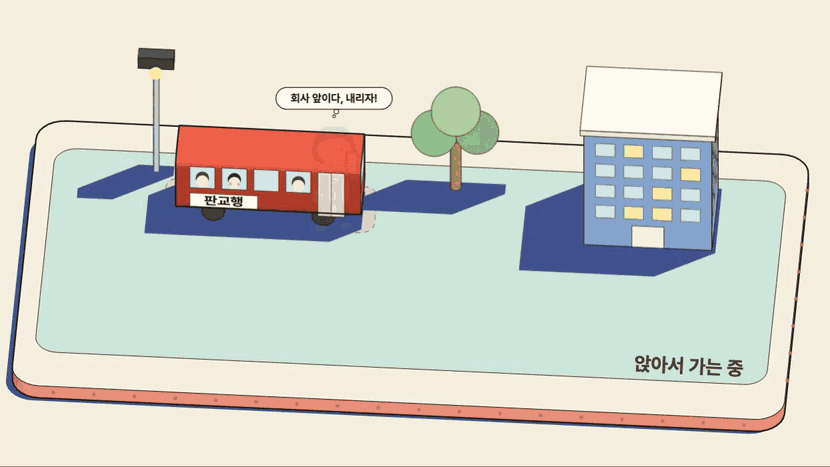

회사에 도착했습니다. 오늘 출근길은 여기까지입니다.

<b>이건 보내고 앞 정류장으로 걸어가자!</b>

 

<b>여기는 자리 있다, 타자!</b>

 

<b>회사 앞이다, 내리자!</b>

 

회사에 도착했습니다. 오늘 출근길은 여기까지입니다.

<b>어, 한번 열어 봤는데 자리가 없대...</b>

 

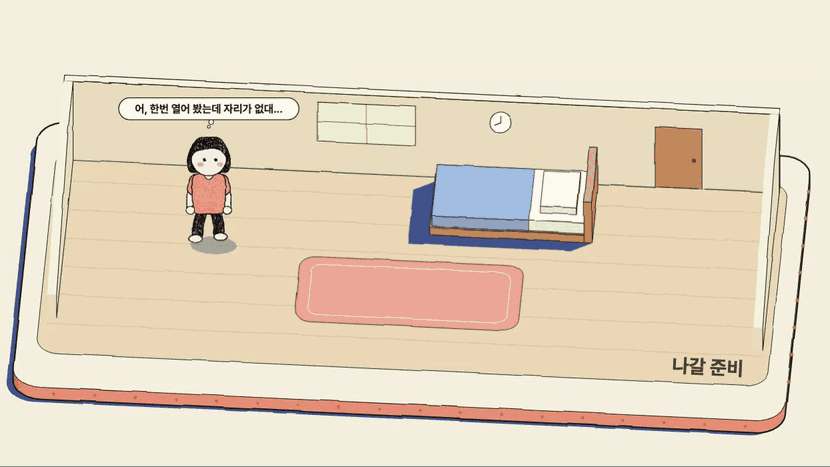

<b>고양이 쓰다듬기</b>

 

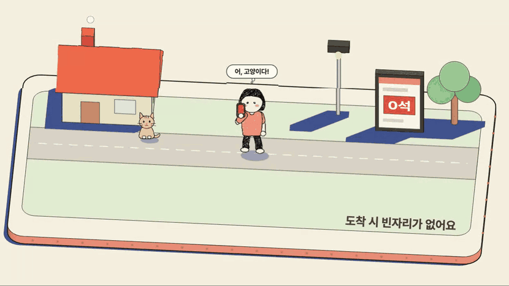

헐, 시간이 없어! 위나 아래에서 다시 골라 보세요.

<b>앞 정류장으로 옮겨서 타자!</b>

 

<b>여기는 자리 있다, 타자!</b>

 

<b>회사 앞이다, 내리자!</b>

 

회사에 도착했습니다. 오늘 출근길은 여기까지입니다.

<b>다음 차는 어떨까? 오, 다음 차는 3석 남는대!</b>

 

<b>고양이 쓰다듬기</b>

 

헐, 시간이 없어! 위나 아래에서 다시 골라 보세요.

<b>어, 내 정류장으로 가도 되겠다!</b>

 

<b>버스 온다! 오, 자리 있다!</b>

 

<b>얼른 타자!</b>

 

<b>회사 앞이다, 내리자!</b>

 

회사에 도착했습니다. 오늘 출근길은 여기까지입니다.

<b>버스 온다! 헐, 만석이야...</b>

 

<b>이건 보내고 앞 정류장으로 걸어가자!</b>

 

<b>여기는 자리 있다, 타자!</b>

 

<b>회사 앞이다, 내리자!</b>

 

회사에 도착했습니다. 오늘 출근길은 여기까지입니다.

<b>다음 차는 어떨까? 헐, 다음 차도 자리가 없대...</b>

 

<b>고양이 쓰다듬기</b>

 

헐, 시간이 없어! 위나 아래에서 다시 골라 보세요.

<b>앞 정류장으로 옮겨서 타자!</b>

 

<b>여기는 자리 있다, 타자!</b>

 

<b>회사 앞이다, 내리자!</b>

 

회사에 도착했습니다. 오늘 출근길은 여기까지입니다.

<b>아, 못 믿겠어. 그냥 내 감으로 가 보자!</b>

 

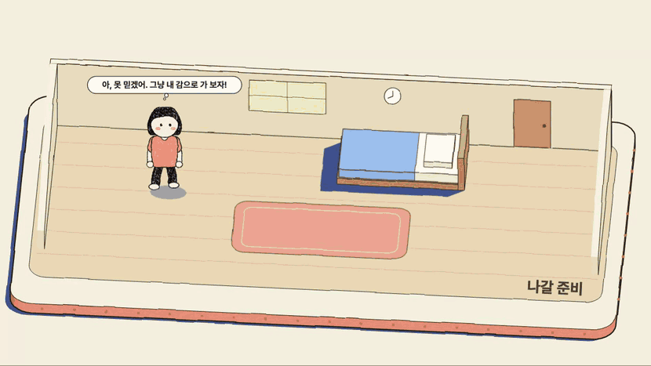

<b>버스 온다! 오, 자리 있다!</b>

 

<b>얼른 타자!</b>

 

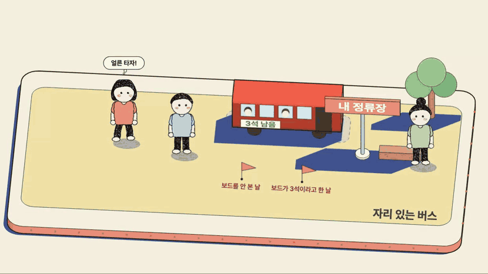

<b>회사 앞이다, 내리자!</b>

 

회사에 도착했습니다. 오늘 출근길은 여기까지입니다.

<b>버스 온다! 헐, 만석이야...</b>

 

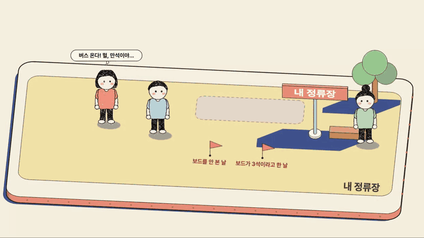

<b>이건 보내고 다음 차를 보자. 오, 다음 차는 3석 남는대!</b>

 

<b>그럼 여기서 기다리자!</b>

 

<b>버스 온다! 오, 자리 있다!</b>

 

<b>얼른 타자!</b>

 

<b>회사 앞이다, 내리자!</b>

 

회사에 도착했습니다. 오늘 출근길은 여기까지입니다.

<b>버스 온다! 헐, 만석이야...</b>

 

<b>이건 보내고 앞 정류장으로 걸어가자!</b>

 

<b>여기는 자리 있다, 타자!</b>

 

<b>회사 앞이다, 내리자!</b>

 

회사에 도착했습니다. 오늘 출근길은 여기까지입니다.

<b>이건 보내고 다음 차를 보자. 헐, 다음 차도 자리가 없대...</b>

 

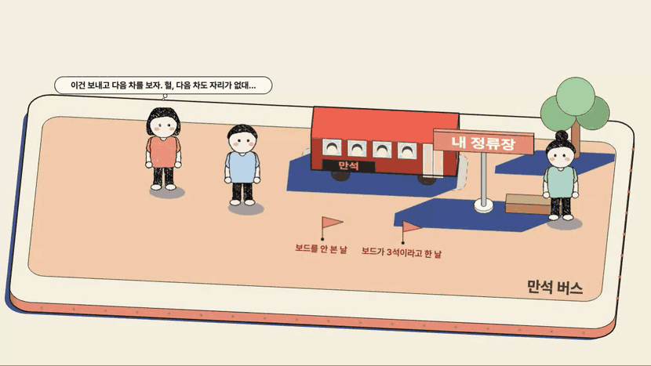

<b>앞 정류장으로 옮겨서 타자!</b>

 

<b>여기는 자리 있다, 타자!</b>

 

<b>회사 앞이다, 내리자!</b>

 

회사에 도착했습니다. 오늘 출근길은 여기까지입니다.

<b>이건 보내고 앞 정류장으로 걸어가자!</b>

 

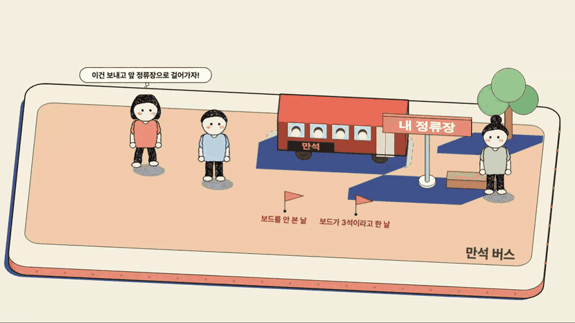

<b>여기는 자리 있다, 타자!</b>

 

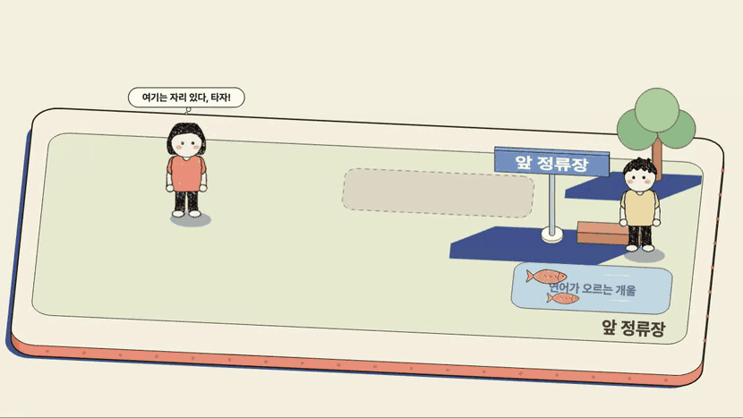

<b>회사 앞이다, 내리자!</b>

 

회사에 도착했습니다. 오늘 출근길은 여기까지입니다.

[로컬 개발 환경 실행 안내](dev/README.md)
